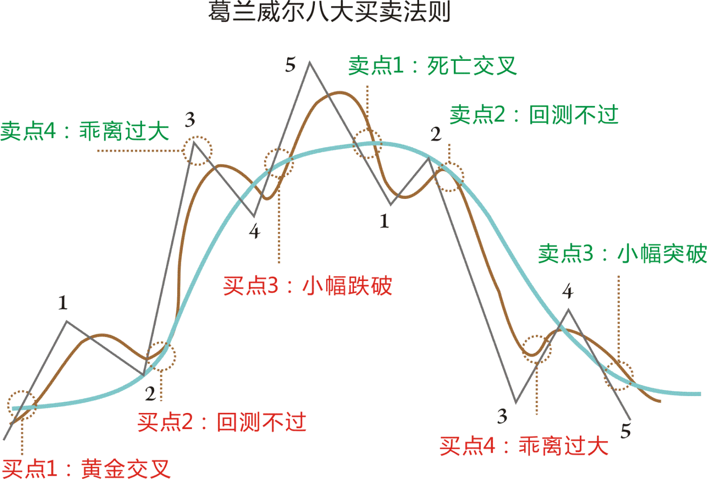
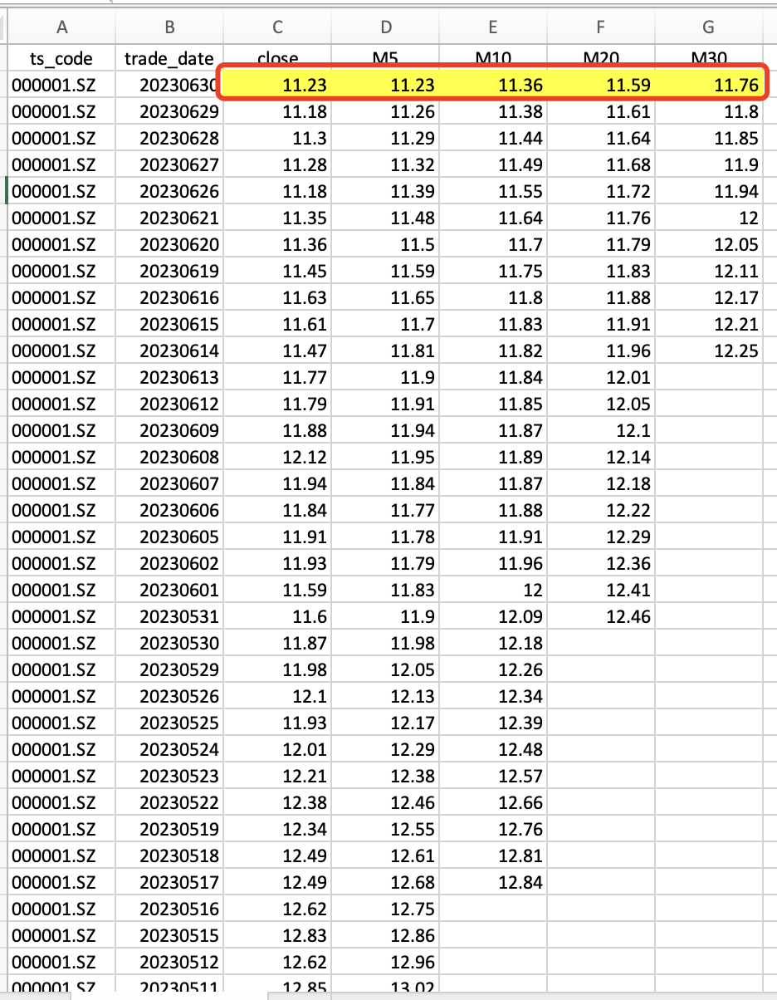

# 05_量化择时策略

目录

5.1 什么是量化择时策略

5.2 量化择时的策略

5.3 常见经典指标

5.4 常见经典策略

5.5 回测实战

## 5.1 什么是量化择时

量化择时策略，简单来说，就是采用数量化分析方法，利用单个或多个技术指标的组合，来对交易标的股票或股票指数进行低买高卖的操作，期望获得超越简单买入持有策略的收益风险表现。

量化择时策略的核心是技术分析，更准确地来说，是客观型技术分析。客观型技术分析，是指其分析过程中所用到的分析方法，具有100%客观的定义标准，不含有任何主观定义的部分。

基于客观型技术分析的量化择时策略，对普通投资者具有一个很重要的意义，那就是具有很强的可传授性和可复制性 ，任何人只要花费时间精力去理解、去掌握了这些有效的量化择时策略，都可以将它们付之于实盘，获得同样令人满意的投资业绩。

### 5.1.1 量化择时的内容

正如巴菲特在谈论市场时说：“我们所经历的上个世纪反复证明，股票市场的非理性是周期性爆发的。这强烈暗示投资者应尽力去学会应对下一个股票市场的非理性爆发。而这需要的是一剂解毒剂，我认为这剂解毒剂就是量化分析。如果你定量分析，你并不一定会出色，但是你也不会坠入疯狂。”，所谓量化择时即为：根据量化指标，来选择买卖的时机。量化择时分市场整体择时、板块行业轮动择时及个股的择时。

量化择时的意义重大，如果能选择牛市、规避熊市，将能够获得非常高超额收益。尤其是在系统性风险较高、波动性比较大的、相关性较强的新兴A股市场，尤为有效。根据A股市场数据计算，从1991年1月到2010年7月的234个月月平均收益为2.18%，去掉最差的十个月（占总时间的4.27%），则收益提高到4.23%；如果去掉最好的10个月，则收益降到0.01%。如果投资者从2006年初的市场底部进入，则收益巨大；如果从2008年初进入，则亏损很多。可见选择时机进入是投资决策的首要目标，低风险区域进入能增大安全边际。

### 5.1.2 量化择时的优点

很明显，按照择时指标买卖指数基金或者一篮子成分股等，可以省去选股的复杂工作，相对于买入并持有策略，能获得较高的超额收益，并降低风险。但是择时难度也较大，我们试图通过量化的方法来择时，主要分为宏观先行指标、市场情绪指标、整体估值指标以及其他技术分析指标。主要是目标是观察和定位市场的长期状态区间（牛市或熊市），在大概率下预测中期趋势（是上涨还是下跌），及时捕捉短期拐点。一般情况下，适合大类资产配置。


## 5.2 量化择时的策略

常见的客观性技术分析有：均线、MACD、RSI等，它们都具有一个共同点，就是都有明确的数学计算公式，只要给出计算公式，任何人计算出来的结果都是一样的，比如20日简单均线，不管是谁画出来的均线都是一样的。

这些客观型技术分析指标按性能及设计特征，归纳了八种量化择时方法： 趋势择时、 Hurst指数、SWARCH模型、异常指标择时、市场情绪择时、SVM分类、有效资金模型、牛熊线。

### 5.2.1 异常指标择时

异常指标择时主要处理一些特殊情况下的择时，例如，在大盘出现顶点或者低点的时候，有些指标容易出现异常数据，主要有：市场噪声、行业集中度和兴登堡凶兆3个策略。

### 5.2.2 趋势择时

趋势择时的基本思想来自于技术分析，技术分析认为趋势存在延续性，因此只要找到趋势方向，跟随操作即可。趋势择时的主要指标有MA、MACD、DMA等，

### 5.2.3 有效资金择时

有效资金是指市场上能对趋势产生影响的资金流，同样的资金量，在趋势顶部和底部的时候，对市场的影响是不一样的。从大概率的角度来看，当股价愈接近顶部时，上涨1%所需要的主动买入资金越多，上涨也就越困难，也就是通常理解的“滞涨”或者“顶部放量”，此时的成交金额更能反应股价的高低，对于股价的指示更有效，而底部则刚好相反。

有效资金模型就是构建有效资金指标EMS（这就是该策略的构造要点）来判断一波趋势是否接近拐点的策略。

有效资金模型和选股模型中的资金流模型类似，其是通过判断推动大盘上涨或者下跌的有效资金来判断走势，因为在顶部和底部时资金效果具有额外的推动力。

EMS指标的直观解释：按照通常理解，无论是传统资金流量，还是MS、EMS指标，当指标值为正时，我们认为资金为净流入或者主动性买入资金多于主动性卖出资金，因此很多人认为该指标越大就越应该看好后市。

然而如果我们从另外一个角度来看，指标值越大说明股票的上涨阻力越来越大，因为上涨所需要付出的成交金额越大，特别是EMS指标对正向MS和负向MS按照有效性进行了加权，EMS越大时，上涨单位价格所需的资金越多，上涨阻力越大；反之，EMS越小时，下跌单位价格所需的资金越多，下跌阻力越大。

### 5.2.4 市场情绪择时

A 股市场正处于弱有效阶段，个人投资者居多，由于缺乏时间、精力及知识能力去分析股票的投资价值，
往往会受到周围人的影响，具有羊群效应。市场情绪择时就是利用投资者的热情程度（投资信心指数）来判断大势方向，当情绪热烈，积极入市时，大盘可能会继续涨；当投资者情绪低迷、不断撤出市场的时候，大盘可能继续下跌。

### 5.2.5 SVM择时

SVM是一种分类技术，具有效率高、推广性能好的优点，SVM择时就是利用SVM技术进行大盘趋势的模式识别，将大盘区分为几个明显的模式，从而找出其中的特征，然后利用历史数据学习的模型来预测未来的趋势，近些年也有类似的model。

### 5.2.6 SWARCH择时

SWARCH模型是海通证券开发的一种利用宏观经济指标来判断大盘的策略，该模型主要刻画了货币供应量M2和大盘走势之间的关系，揭示我国证券市场指数变化与货币供应量之间的相关关系。

### 5.2.7 牛熊线择时

牛熊线（年线，一般是指250日移动平均线）择时的思想就是将大盘的走势划分为两根线，一根为牛线，一根为熊线。在牛熊线之间时大盘不具备方向性，如果突破牛线，则可以认为是一波大的上涨趋势的到来；如果突破熊线，则可以认为是一波大的下跌趋势到来。

### 5.2.8 Hurst指数

Hurst指数是分形理论在趋势判断中的应用，分形市场理论认为，资本市场是由大量具有不同投资期限的投资者组成的，且信息对不同投资者的交易周期有着不同的影响。利用Hurst指数可以将市场的转折点判断出来，从而实现择时。

具体来说

赫斯特指数有三种形式：

1．如果H=0.5，表明时间序列可以用随机游走来描述；

2．如果0.5<H<1，表明时间序列存在长期记忆性；

3．如果0≤H<0.5，表明粉红噪声(反持续性)即均值回复过程。也就是说，只要H≠0.5，就可以用有偏的布朗运动(分形布朗运动)来描述该时间序列数据。


时至今日，这些基本的技术指标如果单独运用形成一套量化择时策略来指导投资买卖，往往并不能带来令人满意投资效果，但是它们所隐含的方法内涵却依然是更复杂更有效的量化择时策略的基础，是我们开发有效的量化择时策略的基本工具。

因此，在开始阶段，我们仍然有必要对这些基础技术指标进行深入研究，理解它们的构造原理，熟悉它们的性能特征.

参考：

- https://www.dxqh.net/fck/attached/file/20170112/20170112135032_0793.pdf
- https://www.htsec.com/jfimg/colimg/upload/20210301/41161614561953400.pdf
- https://wiki.mbalib.com/wiki/%E9%87%8F%E5%8C%96%E6%8B%A9%E6%97%B6
- http://www.cfachina.org/servicesupport/analygarden/jrl/fxszh6/202205/P020220520850234514295.pdf
- https://research.cicc.com/frontend/recommend/detail?id=3050
- 《量化投资—策略与技术》（丁鹏著，电子工业出版社）
- https://www.dxqh.net/fck/attached/file/20170112/20170112135032_0793.pdf
- https://www.htsec.com/jfimg/colimg/upload/20210301/41161614561953400.pdf
- https://wiki.mbalib.com/wiki/%E9%87%8F%E5%8C%96%E6%8B%A9%E6%97%B6
- http://www.cfachina.org/servicesupport/analygarden/jrl/fxszh6/202205/P020220520850234514295.pdf
- https://research.cicc.com/frontend/recommend/detail?id=3050
- 《量化投资—策略与技术》（丁鹏著，电子工业出版社）

## 5.3 常见经典指标

下面按小节给出十个经典量化指标的实现，后面的章节会讲解如何用到它们。为保证代码简洁，先说明依赖，各指标函数都会直接用到导入的库。

**依赖**

```python
import numpy as np
import pandas as pd
```

---

### 5.3.1 均线

在股票市场中，均线是一个非常常见的名词术语，并且很多量化策略也都围绕着不同的均线展开。

均线也叫移动平均线，是由著名的美国投资专家Joseph E.Granville（格兰威尔）在20世纪中期提出来的，现在仍然广泛为人们使用，成为判断买卖信号的一大指标。从统计角度来说，均线就是历史价格的平均值，可以代表过去N日股价的平均走势。

1962年7月，Joseph E.Granville在他的书中提出了著名的Granville八大买卖法则。只利用股价和均线即可进行择时，方法简单有效，一经提出，迅速受到市场追捧。尤其是其中的金叉和死叉信号，更是沿用至今。Granville 八大法则其中有四条是用于判断买进时机，另外四条是用于判断卖出时机。买进和卖出法则一一对应，分布在高点的左右两侧（除买4和卖4以外）。法则内容如下所示：

- 买1：均线整体上行，股价由下至上上穿均线，此为黄金交叉，形成第一个买点。
- 买2：股价出现下跌迹象，但尚未跌破均线，此时均线变成支撑线，形成第二个买点。
- 买3：股价仍处于均线上方，但呈现急剧下跌趋势。当跌破均线时，出现第三个买点。
- 买4：（右侧）股价和均线都处于下降通道，且股价处于均线下方，严重远离均线，出现第四个买点。


- 卖1：均线由上升状态变为缓慢下降的状态，股价也开始下降。当股价跌破均线时，此为死亡交叉，形成第一个卖点。
- 卖2：股价仍处于均线之下，但股价开始呈现上涨趋势，当股价无限接近均线但尚未突破时，此时均线变成阻力线，形成第二个卖点。
- 卖3：股价终于突破均线，处于均线上方。但持续时间不长，股价开始下跌，直至再一次跌破均线，此为第三个卖点。
- 卖4：（左侧）股价和均线都在上涨，股价上涨的速度远快于均线上涨的速度。当股价严重偏离均线时，出现第四个卖点。





**简单均线与指数均线**：

常见的均线包括简单移动平均线（SMA）和指数移动平均线（EMA）。

简单移动平均线（SMA）是通过将一段时间内的价格加总，然后除以时间段的长度来计算的。例如，20日简单移动平均线是根据过去20个交易日的收盘价来计算的。

指数移动平均线（EMA）是根据指数平滑系数来计算的，它更加关注最近的价格数据。较新的价格数据会给予更高的权重，而较旧的价格数据则给予较低的权重。EMA的计算公式可以包含一个初始EMA值，以及指数平滑系数。

均线可以帮助分析趋势和价格的走势，以及确定潜在的买入和卖出信号。例如，当价格上涨并且价格位于均线之上时，这可能被视为一个买入信号。相反，当价格下跌并且价格位于均线之下时，这可能被视为一个卖出信号。

许多量化策略使用不同时间长度的均线来比较，以确定交易信号。例如，交叉均线策略使用两条不同长度的移动均线，当短期均线穿过长期均线时产生交易信号。

需要注意的是，均线是一种技术工具，仅作为参考和辅助分析工具。在使用均线进行决策时，还需要结合其他技术指标和市场因素进行综合分析。


**均线计算**：

均线计算通常使用`df.rolling(..).mean()`，或`df.rolling(...).ewm()`来实现。

我们结合金融软件具体查看一下该指标。目前各大金融软件基本都提供移动平均值的计算，如下截图展示了平安银行（000001.SZ）2023年4月到6月的估价走势，在右上角展示了5日移动平均值（M5）、10日移动平均值（M10）、20日移动平均值（M20）、30日移动平均值（M30）。

为了进一步计算验证，本文拉取了20230501 - 20230630 交易日每天的日行情数据，根据收盘价计算，可以看出该[计算结果](result.csv)与金融产品上展示的数据一致。





### 5.3.2 RSI（相对强弱指标）

RSI 通过比较一段时期内平均上涨幅度与平均下跌幅度，衡量多空力量强弱，数值在 0 到 100 之间，常用于判断超买（如 70 以上）和超卖（如 30 以下）。

```python
def rsi(df, metric_col="rsi", in_place=False, period=14):
    # 非原地模式先拷贝一份，避免修改调用方的 DataFrame
    if not in_place:
        df = df.copy()
    close = df["close"]
    # 相邻两日收盘价的差值；上涨为正，下跌为负
    delta = close.diff()
    # 把负值截断为 0，只保留上涨幅度（其余置 0）
    gain = delta.clip(lower=0)
    # 先取负、再把正值截断为 0，得到纯下跌幅度（全部为非负值）
    loss = -delta.clip(upper=0)

    # Wilder 平滑：用 EWM 指数加权（alpha=1/period）近似 RSI 的惯用算法
    # min_periods=period 保证前 period 天数据不足时结果为 NaN
    avg_gain = gain.ewm(alpha=1 / period, adjust=False, min_periods=period).mean()
    avg_loss = loss.ewm(alpha=1 / period, adjust=False, min_periods=period).mean()

    # RS = 平均涨幅 / 平均跌幅；分母为 0 时替换为 NaN，避免除零
    rs = avg_gain / avg_loss.replace(0, np.nan)
    # RSI = 100 - 100/(1+RS)，取值范围 0~100
    rsi_ = 100 - 100 / (1 + rs)
    # 兜底：平均跌幅为 0 而平均涨幅 > 0 → 单边上涨，RSI 取 100
    rsi_ = rsi_.mask((avg_loss == 0) & (avg_gain > 0), 100.0)
    # 兜底：涨跌幅都为 0（横盘不动）→ RSI 取中性值 50
    rsi_ = rsi_.mask((avg_loss == 0) & (avg_gain == 0), 50.0)

    df[metric_col] = rsi_
    return df
```

---

### 5.3.3 MACD（指数平滑异同移动平均）

MACD称为异同移动平均线（Moving Average Convergence and Divergence），是由指数均线演变而来的，由Gerald Appel在1979年提出，是一个比较常见的技术指标。MACD指标通过对金融资产价格的收盘价进行平滑处理，生成了两线一柱组合，其中两线是快速线DIF（Difference Line）和慢速线DEA（Signal Line），一柱是柱状图MACD。MACD指标是快速线DIF与慢速线DEA的差，可以反映出股票近期价格走势的变化强弱和能量，用于把握股票的准确买卖点。

**MACD计算**：

**短期EMA：**短期（如，12天）的收盘价指数移动平均值，一般采用EMA(price, 12)

**长期EMA：**长期（如，26天）的收盘价指数移动平均值，一般采用EMA(price, 26)

**DIF：**短期EMA与长期EMA的差值，即DIF=EMA(price, 12)-EMA(price, 26)

**DEA：**DIF的多日（如，9天）指数移动平均值，即DEA=EMA(DIF, 9)

**MACD：**DIF线与DEA线的差，即MACD=DIF-DEA


```python
def macd(df, metric_col=("macd", "macd_signal", "macd_hist"),
         in_place=False, fast=12, slow=26, signal=9):
    # 非原地模式先拷贝一份，避免修改调用方的 DataFrame
    if not in_place:
        df = df.copy()
    close = df["close"]
    # 快线：收盘价 12 日指数移动平均（对近期价格权重更大，反应更快）
    ema_fast = close.ewm(span=fast, adjust=False).mean()
    # 慢线：收盘价 26 日指数移动平均（更平滑，反应更慢）
    ema_slow = close.ewm(span=slow, adjust=False).mean()

    # DIF（快线）：快慢均线差值，反映价格动量方向；正为多头动能，负为空头
    macd_line = ema_fast - ema_slow
    # DEA（慢线）：DIF 的 9 日指数移动平均，对 DIF 再做一次平滑，降低噪声
    signal_line = macd_line.ewm(span=signal, adjust=False).mean()
    # HIST（柱状图）：DIF 与 DEA 的差值，即 MACD 柱；
    # 柱值扩大/收窄反映 DIF 偏离 DEA 的程度，可提前感知动能变化
    hist = macd_line - signal_line

    cols = list(metric_col)
    for name, series in zip(cols, [macd_line, signal_line, hist]):
        df[name] = series
    return df
```

---

### 5.3.4 KDJ（随机指标）

KDJ 基于一定周期内的最高价、最低价和收盘价计算未成熟随机值 RSV，再平滑得到 K、D、J 三条线；K、D 用于超买超卖判断，J 值更敏感，常辅助捕捉拐点。

```python
def kdj(df, metric_col=("k", "d", "j"),
        in_place=False, n=9, k_period=3, d_period=3):
    # 非原地模式先拷贝一份，避免修改调用方的 DataFrame
    if not in_place:
        df = df.copy()
    # 近 n 日最低价 / 最高价（min_periods=n 保证窗口满 n 天才有值，前 n-1 天为 NaN）
    low_n = df["low"].rolling(n, min_periods=n).min()
    high_n = df["high"].rolling(n, min_periods=n).max()

    # 分母为 0（最高价=最低价）时替换为 NaN，避免除零
    denom = (high_n - low_n).replace(0, np.nan)
    # RSV（未成熟随机值）：收盘价在 n 日区间中的相对位置，0~100；
    # 接近 100 表示价格贴近 n 日最高位（超买区），接近 0 表示贴近最低位（超卖区）
    rsv = (df["close"] - low_n) / denom * 100
    # 最高价=最低价（横盘）时 RSV 取中性值 50，避免无意义的 0/0
    rsv = rsv.mask(denom == 0, 50.0)

    # K 线：RSV 的 3 日指数平滑（alpha=1/3），消除 RSV 的跳动
    k = rsv.ewm(alpha=1 / k_period, adjust=False).mean()
    # D 线：K 线的 3 日指数平滑，比 K 更平缓
    d = k.ewm(alpha=1 / d_period, adjust=False).mean()
    # J 线：3K - 2D，对 K、D 偏离的放大；J>100 视为超买、J<0 视为超卖
    j = 3 * k - 2 * d

    cols = list(metric_col)
    for name, series in zip(cols, [k, d, j]):
        df[name] = series
    return df
```

---

### 5.3.5 BOLL（布林带）

布林带由中轨（收盘价均线）和上下轨（中轨 ± k 倍标准差）构成，用于刻画价格波动区间；价格触及上下轨、带宽收缩或扩张常用于判断突破与均值回归机会。

```python
def boll(df, metric_col=("boll_mid", "boll_upper", "boll_lower"),
         in_place=False, period=20, std_mult=2.0):
    # 非原地模式先拷贝一份，避免修改调用方的 DataFrame
    if not in_place:
        df = df.copy()
    close = df["close"]
    # 中轨：20 日简单移动平均，代表一段时间的价格中枢
    mid = close.rolling(period, min_periods=period).mean()
    # 波动度：20 日总体标准差（ddof=0 总体口径；部分软件用 ddof=1 样本口径）
    std = close.rolling(period, min_periods=period).std(ddof=0)

    # 上轨 = 中轨 + 2 倍标准差；下轨 = 中轨 - 2 倍标准差；
    # 约 95% 的价格应落在带内；带宽收窄（收口）常预示即将突破，扩张则常伴随趋势加速
    upper = mid + std_mult * std
    lower = mid - std_mult * std

    cols = list(metric_col)
    for name, series in zip(cols, [mid, upper, lower]):
        df[name] = series
    return df
```

---

### 5.3.6 MA / EMA（移动平均线与指数移动平均线）

MA 是收盘价的简单移动平均，EMA 对近期价格赋予更高权重；两者都是最基础的趋势跟踪工具，常用于判断趋势方向、支撑阻力和均线交叉信号。

```python
def ma_ema(df, metric_col=("ma", "ema"),
           in_place=False, ma_period=20, ema_period=20):
    # 非原地模式先拷贝一份，避免修改调用方的 DataFrame
    if not in_place:
        df = df.copy()
    close = df["close"]
    # MA（简单移动平均）：窗口内收盘价的算术平均；窗口未满时为 NaN，
    # 对窗口内每个点权重相同，整体反应偏慢
    ma = close.rolling(ma_period, min_periods=ma_period).mean()
    # EMA（指数移动平均）：递推平滑，越近的收盘价权重越高，对趋势变化反应更快；
    # 注意 EWM 从首行开始累积，无"窗口未满"概念，前几日的值仅供参考
    ema = close.ewm(span=ema_period, adjust=False).mean()

    cols = list(metric_col)
    for name, series in zip(cols, [ma, ema]):
        df[name] = series
    return df
```

---

### 5.3.7 ATR（平均真实波幅）

ATR 先计算真实波幅 TR（当日振幅与跳空缺口的最大值），再平滑求均值，用于衡量价格波动幅度，本身不含方向，常用于止损设置和仓位规模管理。

```python
def atr(df, metric_col="atr", in_place=False, period=14):
    # 非原地模式先拷贝一份，避免修改调用方的 DataFrame
    if not in_place:
        df = df.copy()
    high, low, close = df["high"], df["low"], df["close"]
    # 前一日收盘价（首日为 NaN）
    prev_close = close.shift(1)

    # TR（真实波幅）取以下三者最大值：
    # 1) 当日最高-最低价：当日振幅
    # 2) 当日最高-昨收：向上跳空缺口
    # 3) 昨收-当日最低：向下跳空缺口
    # 这样跳空缺口也被计入真实波幅，比单纯的高-低更准确
    tr = pd.concat(
        [
            (high - low).abs(),
            (high - prev_close).abs(),
            (low - prev_close).abs(),
        ],
        axis=1
    ).max(axis=1)

    # ATR = TR 的 Wilder 平滑（EWM，alpha=1/period），反映平均日波动幅度；
    # 数值越高波动越大，常用于止损距离设定和仓位管理（如按 ATR 的倍数设置止损）
    out = tr.ewm(alpha=1 / period, adjust=False, min_periods=period).mean()
    df[metric_col] = out
    return df
```

---

### 5.3.8 ADX / DMI（趋向指标）

DMI 通过比较上涨动向和下跌动向得到 +DI、-DI，衡量多空方向；ADX 是 DX 的平滑值，用来度量趋势强度。ADX 较高通常表示趋势明确，较低表示震荡。

```python
def adx_dmi(df, metric_col=("adx", "plus_di", "minus_di"),
            in_place=False, period=14):
    # 非原地模式先拷贝一份，避免修改调用方的 DataFrame
    if not in_place:
        df = df.copy()
    high, low, close = df["high"], df["low"], df["close"]
    prev_close = close.shift(1)

    # up/down 用 diff 得到当日最高价/最低价的环比变动（注意不是涨跌幅）
    up = high.diff()
    down = -low.diff()

    # +DM（上涨动向）：当日最高价涨幅 > 最低价跌幅 且 > 0 时取涨幅，否则 0
    plus_dm = pd.Series(
        np.where((up > down) & (up > 0), up, 0.0),
        index=df.index
    )
    # -DM（下跌动向）：当日最低价跌幅 > 最高价涨幅 且 > 0 时取跌幅，否则 0
    minus_dm = pd.Series(
        np.where((down > up) & (down > 0), down, 0.0),
        index=df.index
    )

    # TR（真实波幅）：同 ATR 指标中的算法，三者取最大
    tr = pd.concat(
        [
            (high - low),
            (high - prev_close).abs(),
            (low - prev_close).abs(),
        ],
        axis=1
    ).max(axis=1)

    alpha = 1 / period
    # 三项分别做 Wilder 平滑（EWM，alpha=1/period）
    atr_ = tr.ewm(alpha=alpha, adjust=False, min_periods=period).mean()
    plus_dm_s = plus_dm.ewm(alpha=alpha, adjust=False, min_periods=period).mean()
    minus_dm_s = minus_dm.ewm(alpha=alpha, adjust=False, min_periods=period).mean()

    # +DI / -DI：动向值占 TR 的比例（×100）；分母为 0 时替换为 NaN，避免除零
    plus_di = 100 * plus_dm_s / atr_.replace(0, np.nan)
    minus_di = 100 * minus_dm_s / atr_.replace(0, np.nan)

    # DX：+DI 与 -DI 差值绝对值占两者之和的比例，度量趋势的明确程度；
    # 两者之和为 0（无趋势）时替换为 NaN
    dx = 100 * (plus_di - minus_di).abs() / (plus_di + minus_di).replace(0, np.nan)
    # ADX：DX 的 Wilder 平滑；ADX>25 常被认为趋势明确（配合 DI 判断方向），
    # ADX<20 多为震荡市
    adx = dx.ewm(alpha=alpha, adjust=False, min_periods=period).mean()

    cols = list(metric_col)
    for name, series in zip(cols, [adx, plus_di, minus_di]):
        df[name] = series
    return df
```

---

### 5.3.9 CCI（顺势指标）

CCI 计算典型价格与其移动平均的偏离程度，并用平均绝对偏差做标准化；数值突破 +100 或 -100 常被视为趋势启动信号，也用于识别超买超卖。

```python
def cci(df, metric_col="cci", in_place=False, period=20, constant=0.015):
    # 非原地模式先拷贝一份，避免修改调用方的 DataFrame
    if not in_place:
        df = df.copy()
    # TP（典型价格）：(最高 + 最低 + 收盘) / 3，比单纯用收盘价更全面地反映当日价格区间
    tp = (df["high"] + df["low"] + df["close"]) / 3
    # 典型价格的 20 日简单移动平均
    sma = tp.rolling(period, min_periods=period).mean()

    # MAD（平均绝对偏差）：窗口内各点与均值的偏差的绝对值平均；
    # apply(raw=True) 对滚动窗口逐行执行 lambda，比纯 Python 快
    mad = tp.rolling(period, min_periods=period).apply(
        lambda x: np.mean(np.abs(x - np.mean(x))),
        raw=True
    )

    # CCI = (TP - MA) / (K * MAD)，constant=0.015 是经验系数，用来把 CCI 的取值
    # 压缩到便于观察的范围；分母 MAD 为 0（价格完全横盘）时替换为 NaN 避免除零
    # 经验阈值：CCI > +100 视为进入强势区（可能突破）；CCI < -100 视为进入弱势区
    out = (tp - sma) / (constant * mad.replace(0, np.nan))
    df[metric_col] = out
    return df
```

---

### 5.3.10 OBV（能量潮）

OBV 将成交量按当日涨跌方向累加（涨则加、跌则减），用于观察资金流入流出与量价配合；OBV 与价格走势背离时，常被视为潜在反转信号。

```python
def obv(df, metric_col="obv", in_place=False):
    # 非原地模式先拷贝一份，避免修改调用方的 DataFrame
    if not in_place:
        df = df.copy()
    close = df["close"]
    volume = df["volume"]

    # 当日涨跌方向：涨 +1、跌 -1、平 0；np.sign 把 0 也返回 0，首行 diff 为 NaN 填 0
    direction = np.sign(close.diff()).fillna(0)
    # 按方向累加成交量：上涨加、下跌减、平盘不变，得到资金净流入的累计量
    out = (direction * volume).cumsum()

    df[metric_col] = out
    return df
```

---

### 5.3.11 ROC（变动率指标）

ROC 衡量当前价格相对若干周期前价格的变化百分比，是一个动量指标；ROC 为正且上升表示上涨动量增强，穿越零轴常用于判断趋势转换。

```python
def roc(df, metric_col="roc", in_place=False, period=12):
    # 非原地模式先拷贝一份，避免修改调用方的 DataFrame
    if not in_place:
        df = df.copy()
    close = df["close"]
    # ROC = 当前收盘价相对 period 日前收盘价的涨幅（%）；
    # 前 period 天数据不足、以及分母（period 日前收盘价）为 0 时替换为 NaN 避免除零
    out = (close - close.shift(period)) / close.shift(period).replace(0, np.nan) * 100
    df[metric_col] = out
    return df
```


## 5.4 常见经典策略


### 5.4.1 RSI 均值回归策略

利用 RSI 在超卖区（默认 30）回升和超买区（默认 70）回落判断反转：RSI 上穿超卖线开多，RSI 下穿超买线平多。

```python
def rsi_strategy(df, signal_col="rsi_signal", in_place=False,
                 period=14, oversold=30, overbought=70):
    """RSI 均值回归策略。

    参数:
        df          : 含 open/close/high/low/volume 的数据帧
        signal_col  : 输出信号列名
        in_place    : True 时原地修改 df，False 时返回副本
        period      : RSI 平滑周期，经典取 14
        oversold    : 超卖阈值，经典取 30
        overbought  : 超买阈值，经典取 70

    信号约定:
        +1：RSI 从下方上穿 oversold（超卖回升，入场）
        -1：RSI 从上方下穿 overbought（超买回落，出场）
         0：不动作
    """
    # ========== 1. 复用 5.3 节的 rsi() 计算指标 ==========
    # 先算出 RSI 列，再基于它生成信号，避免和 5.3 重复实现
    df = rsi(df, metric_col="rsi", in_place=True, period=period)
    out = df["rsi"]

    # ========== 2. 生成穿越事件信号 ==========
    # 上穿：昨日 RSI < oversold 且 今日 RSI >= oversold
    #   用 shift(1) 取昨日值做比较，才能识别"从下往上穿过"这一瞬间
    buy = (out.shift(1) < oversold) & (out >= oversold)
    # 下穿：昨日 RSI > overbought 且 今日 RSI <= overbought
    sell = (out.shift(1) > overbought) & (out <= overbought)

    # ========== 3. 组装信号列 ==========
    # 默认全 0，按事件覆盖为 +1/-1；dtype=int 让信号可直接参与运算
    signal = pd.Series(0, index=df.index, dtype=int)
    signal[buy] = 1
    signal[sell] = -1

    # in_place=False 时把信号写入副本，不影响调用方的 df
    if not in_place:
        df = df.copy()
    df[signal_col] = signal
    return df
```

---

### 5.4.2 MACD 金叉/死叉策略

基于趋势动量：MACD 线（快慢 EMA 差）上穿信号线为金叉开多，下穿为死叉平多，是最经典的顺势信号之一。

当MACD从负数转向正数，快速线DIF自下而上穿过慢速线DEA时，形成金叉，即买入信号。

当MACD从正数转向负数，快速线DIF自上而下穿过慢速线DEA时，形成死叉，即卖出信号。

当MACD以大角度变化，表示快的移动平均线和慢的移动平均线的差距非常迅速的拉开，代表了一个市场大趋势的转变

上述用法是MACD指标最直接且最经典的用法，具有完全的客观判断标准，可以很方便的用计算机来实现，并对其进行历史测试。MACD还有其他许多用法，比如底背离、顶背离等，但这些用法中的主观判断成份很重，没有统一客观的使用标准，不同的人使用的结果可能大不一样，也难以用计算机来实现。

中证500ETF在2022年12月到2023年6月的走势如下图，MACD指标在下方的窗格。


**优缺点**：

相比双均线策略，MACD将两条线转换成了单个指标，更容易观察，并且避免了双均线策略里两条均线经常在震荡行情下经常发生交叉的现象出现，减少频繁发出假信号的缺陷，MACD适用于研判中长期走势。

MACD指标的核心功能在于度量均线势能的变化，或者说是股价的二阶差变化，当股价上涨开始乏力时，MACD指标往往能较早的发出卖出信号，使得策略能在股价开始拐头下跌时及时离场，这是MACD指标具有较好风险控制能力的原因。

但是，当遇到大型的趋势上涨行情时，MACD指标可能会错误地过早离场，虽然根据策略逻辑，之后还会继续发出买入信号，但难免错失一段利润，所以在趋势上涨行情中，MACD策略的投资收益会不如股票指数的自身涨幅。

```python
def macd_strategy(df, signal_col="macd_signal", in_place=False,
                  fast=12, slow=26, signal=9):
    """MACD 金叉/死叉策略。

    参数:
        fast   : 快线 EMA 周期，经典 12
        slow   : 慢线 EMA 周期，经典 26
        signal : DEA 信号线 EMA 周期，经典 9

    信号约定:
        +1：MACD 线上穿信号线（金叉）
        -1：MACD 线下穿信号线（死叉）
         0：不动作
    """
    # ========== 1. 复用 5.3 节的 macd() 计算指标 ==========
    # macd() 一次性算出 DIF / DEA / HIST 三列，避免这里重复实现 EMA 平滑
    # 列名直接传元组：macd_macd / macd_signal / macd_hist
    df = macd(df, metric_col=("macd_macd", "macd_signal", "macd_hist"), in_place=True,
              fast=fast, slow=slow, signal=signal)
    dif = df["macd_macd"]
    dea = df["macd_signal"]

    # ========== 2. 金叉/死叉判定 ==========
    # 金叉：昨日 DIF < 昨日 DEA 且 今日 DIF > 今日 DEA
    buy = (dif.shift(1) < dea.shift(1)) & (dif > dea)
    # 死叉：昨日 DIF > 昨日 DEA 且 今日 DIF < 今日 DEA
    sell = (dif.shift(1) > dea.shift(1)) & (dif < dea)

    # ========== 3. 组装信号列 ==========
    signal_s = pd.Series(0, index=df.index, dtype=int)
    signal_s[buy] = 1
    signal_s[sell] = -1

    # in_place=False 时把信号写入副本，不影响调用方的 df
    if not in_place:
        df = df.copy()
    df[signal_col] = signal_s
    return df
```

---

### 5.4.3 KDJ 低位金叉策略

KDJ 在低位（K < 20）金叉认为下跌动能衰竭、反弹概率较大，开多；在高位（K > 80）死叉认为上涨动能减弱，平多。

```python
def kdj_strategy(df, signal_col="kdj_signal", in_place=False,
                 n=9, k_period=3, d_period=3, low=20, high=80):
    """KDJ 低位金叉策略。

    参数:
        n        : RSV 回溯窗口（最高/最低价区间），经典 9
        k_period : K 线平滑周期，经典 3
        d_period : D 线平滑周期，经典 3
        low      : 低位阈值，K < low 才允许做多
        high     : 高位阈值，K > high 才允许做空/平多

    信号约定:
        +1：K 上穿 D 且 K < low（低位金叉）
        -1：K 下穿 D 且 K > high（高位死叉）
         0：不动作
    """
    # ========== 1. 复用 5.3 节的 kdj() 计算指标 ==========
    # kdj() 一次性算出 K / D / J 三列，避免这里重复实现 RSV 与平滑
    df = kdj(df, metric_col=("k", "d", "j"), in_place=True,
             n=n, k_period=k_period, d_period=d_period)
    k = df["k"]
    d = df["d"]

    # ========== 2. 低位金叉 / 高位死叉 ==========
    # 低位金叉：K 由下向上穿越 D，且穿越时 K 仍处于低位（< low）
    buy = (k.shift(1) < d.shift(1)) & (k > d) & (k < low)
    # 高位死叉：K 由上向下穿越 D，且穿越时 K 仍处于高位（> high）
    sell = (k.shift(1) > d.shift(1)) & (k < d) & (k > high)

    # ========== 3. 组装信号列 ==========
    signal = pd.Series(0, index=df.index, dtype=int)
    signal[buy] = 1
    signal[sell] = -1

    # in_place=False 时把信号写入副本，不影响调用方的 df
    if not in_place:
        df = df.copy()
    df[signal_col] = signal
    return df
```

---

### 5.4.4 BOLL 均值回归策略

价格触及外轨代表短期偏离均值过远：跌破下轨后再收回 → 反弹入场；升破上轨后再回落 → 平多。

```python
def boll_strategy(df, signal_col="boll_signal", in_place=False,
                  period=20, std_mult=2.0):
    """BOLL 均值回归策略。

    参数:
        period   : 中轨均线周期，经典 20
        std_mult : 上下轨的标准差倍数，经典 2

    信号约定:
        +1：收盘价上穿下轨（跌破后收回，认为超跌反弹）
        -1：收盘价下穿上轨（突破后回落，认为超涨回落）
         0：不动作
    """
    # ========== 1. 复用 5.3 节的 boll() 计算指标 ==========
    # boll() 一次性算出中轨 / 上轨 / 下轨，避免这里重复实现
    # 列名直接传元组：boll_mid / boll_upper / boll_lower
    df = boll(df, metric_col=("boll_mid", "boll_upper", "boll_lower"), in_place=True,
              period=period, std_mult=std_mult)
    upper = df["boll_upper"]
    lower = df["boll_lower"]
    close = df["close"]

    # ========== 2. 穿越事件 ==========
    # 上穿下轨：昨日收盘 < 昨日下轨 且 今日收盘 > 今日下轨 => 超跌后收回
    buy = (close.shift(1) < lower.shift(1)) & (close > lower)
    # 下穿上轨：昨日收盘 > 昨日上轨 且 今日收盘 < 今日上轨 => 超涨后回落
    sell = (close.shift(1) > upper.shift(1)) & (close < upper)

    # ========== 3. 组装信号列 ==========
    signal = pd.Series(0, index=df.index, dtype=int)
    signal[buy] = 1
    signal[sell] = -1

    # in_place=False 时把信号写入副本，不影响调用方的 df
    if not in_place:
        df = df.copy()
    df[signal_col] = signal
    return df
```

---

### 5.4.5 MA / EMA 双均线策略

**策略原理**：使用两根均线，一根长周期均线，一根短周期均线。当短期均线从下往上穿越长周期均线的时候，买入；当短期均线从上往下穿越长周期均线的时候，卖出。前文介绍的Granville 八大法则也是一种双均线策略，其短周期均线为M1（当日收盘价）。均线根据不同周期有以下分类：

- 短期均线：5、7、10，用于预测短期走势，MA5 和 MA10 又称为短期监测线；
- 中期均线：20、30、60，用于预测中期走势，MA20 和 MA30 又称为警戒线， MA60 则称之为生死线；
- 长期均线：120、250，用于长期走势，MA120 又称为确认线，MA250 则通常被看做反转线，又称为牛熊分界线。


**策略缺陷**：

- **滞后性**：均线归根到底是一种平均值，在应用中存在的最大问题就是滞后性。当出现买入卖出信号时，最佳时机早已过去。举例来说，如果A股票最新价格出现了较大的涨幅，股价和均线都上涨，但均线的速度慢于股价上涨速度。此时，从形态上来看，金叉出现，为买入信号。次日，股价回调，股价下降的速度快于均线下降的速度，形成死叉，为卖点。这样一买一卖不仅没有盈利，反而出现亏损。
- **长短周期难以选择**：如果两根均线的周期接近，比如5日线，10日线，这种非常容易缠绕，不停的产生买点卖点，会有大量的无效交易，交易费用很高。如果两根均线的周期差距较大，比如5日线，60日线，这种交易周期很长，趋势性已经不明显了，趋势转变以后很长时间才会出现买卖点。也就是说可能会造成很大的亏损。所以两个参数选择的很重要，趋势性越强的品种，均线策略越有效。

**策略优化尝试方向**：

- **使用加权移动平均值**：均线策略的一大缺陷是指标具有滞后性，因此可以使用加权移动平均值代替移动平均值。计算时将短期（如昨天）的权重增大，以加强指标的敏感性。
- **不局限于收盘价**：可以尝试将最高价、最低价等加入到加权移动平均值的计算中。
- **自适应调整均线周期**：价格走势进入单边上涨趋势，自适应均线自动缩短周期，采用短期均线，转为向上移动；市场走势进入横盘震荡，自适应均线自动延长周期，采用长期均线，转为横向移动。

```python
def ma_ema_strategy(df, signal_col="ma_signal", in_place=False,
                    short_period=5, long_period=20, use_ema=False):
    """双均线策略（MA 或 EMA）。

    参数:
        short_period : 短均线周期，建议 5~10
        long_period  : 长均线周期，建议 20~60，必须大于 short_period
        use_ema      : True 用 EMA（响应更快），False 用简单 MA（更平滑）

    信号约定:
        +1：短均线上穿长均线（金叉）
        -1：短均线下穿长均线（死叉）
         0：不动作
    """
    # ========== 1. 复用 5.3 节的 ma_ema() 计算短/长均线 ==========
    # ma_ema() 一次同时算出一条 MA 与一条 EMA；短/长两条线周期不同，
    # 需分两次调用，并用不同列名避免两次调用互相覆盖
    df = ma_ema(df, metric_col=("ma_short", "ema_short"),
                ma_period=short_period, ema_period=short_period, in_place=True)
    df = ma_ema(df, metric_col=("ma_long", "ema_long"),
                ma_period=long_period, ema_period=long_period, in_place=True)

    if use_ema:
        short_ma = df["ema_short"]
        long_ma = df["ema_long"]
    else:
        short_ma = df["ma_short"]
        long_ma = df["ma_long"]

    # ========== 2. 金叉/死叉判定 ==========
    # 金叉：昨日短均线 < 昨日长均线 且 今日短均线 > 今日长均线
    buy = (short_ma.shift(1) < long_ma.shift(1)) & (short_ma > long_ma)
    # 死叉：昨日短均线 > 昨日长均线 且 今日短均线 < 今日长均线
    sell = (short_ma.shift(1) > long_ma.shift(1)) & (short_ma < long_ma)

    # ========== 3. 组装信号列 ==========
    signal = pd.Series(0, index=df.index, dtype=int)
    signal[buy] = 1
    signal[sell] = -1

    # in_place=False 时把信号写入副本，不影响调用方的 df
    if not in_place:
        df = df.copy()
    df[signal_col] = signal
    return df
```

---

### 5.4.6 ATR 通道突破策略

把 ATR 当作波动单位，在中轨上方 `k` 倍 ATR 处构建上轨、下方 `k` 倍 ATR 处构建下轨（类似 Keltner 通道）：价格突破上轨视为趋势启动，跌破下轨视为趋势结束。

```python
def atr_strategy(df, signal_col="atr_signal", in_place=False,
                 ma_period=20, atr_period=14, k=2.0):
    """ATR 通道突破策略。

    参数:
        ma_period  : 中轨均线周期，经典 20
        atr_period : ATR 平滑周期，经典 14
        k          : 通道宽度倍数，k 越大越不易被噪声触发

    信号约定:
        +1：收盘价上穿上轨（趋势启动）
        -1：收盘价下穿下轨（趋势结束）
         0：不动作
    """
    close = df["close"]

    # ========== 1. 复用 5.3 节的 atr() 计算指标 ==========
    # atr() 已实现 TR 与 Wilder 平滑，这里直接取 atr 列
    df = atr(df, metric_col="atr", in_place=True, period=atr_period)
    atr_val = df["atr"]

    # ========== 2. 中轨 + ATR 通道 ==========
    # 中轨 = 收盘价均线；上下轨 = 中轨 ± k*ATR
    # ATR 随波动放大/收窄，通道宽度自适应市场状态
    mid = close.rolling(ma_period, min_periods=ma_period).mean()
    upper = mid + k * atr_val
    lower = mid - k * atr_val

    # ========== 3. 穿越事件 ==========
    # 上穿上轨：昨日收盘仍 <= 昨上轨 且 今日收盘 > 今上轨 => 向上突破
    buy = (close.shift(1) <= upper.shift(1)) & (close > upper)
    # 下穿下轨：昨日收盘仍 >= 昨下轨 且 今日收盘 < 今下轨 => 向下突破
    sell = (close.shift(1) >= lower.shift(1)) & (close < lower)

    # ========== 4. 组装信号列 ==========
    signal = pd.Series(0, index=df.index, dtype=int)
    signal[buy] = 1
    signal[sell] = -1

    # in_place=False 时把信号写入副本，不影响调用方的 df
    if not in_place:
        df = df.copy()
    df[signal_col] = signal
    return df
```

---

### 5.4.7 ADX / DMI 趋势策略

DMI 通过 +DI 与 -DI 的相对位置判断多空；ADX 衡量趋势强弱。只在 ADX 高于阈值（默认 25）时，才认为当前方向性突破可信。

```python
def adx_strategy(df, signal_col="adx_signal", in_place=False,
                 period=14, adx_threshold=25):
    """ADX / DMI 趋势策略。

    参数:
        period        : 平滑周期，经典 14
        adx_threshold : ADX 强度门槛，经典 25（>25 视为趋势行情）

    信号约定:
        +1：+DI 上穿 -DI，且 ADX > 阈值（多头趋势确认）
        -1：-DI 上穿 +DI，且 ADX > 阈值（空头趋势确认）
         0：不动作
    """
    # ========== 1. 复用 5.3 节的 adx_dmi() 计算指标 ==========
    # adx_dmi() 一次性算出 ADX / +DI / -DI 三列，避免这里重复实现
    # 列名直接传元组：dmi_adx / dmi_plus_di / dmi_minus_di
    df = adx_dmi(df, metric_col=("dmi_adx", "dmi_plus_di", "dmi_minus_di"), in_place=True, period=period)
    adx = df["dmi_adx"]
    plus_di = df["dmi_plus_di"]
    minus_di = df["dmi_minus_di"]

    # ========== 2. 交叉 + 强度过滤 ==========
    # 多头：+DI 上穿 -DI，且 ADX 超过阈值（趋势够强，避免震荡假信号）
    buy = (plus_di.shift(1) < minus_di.shift(1)) & (plus_di > minus_di) & (adx > adx_threshold)
    # 空头：-DI 上穿 +DI，且 ADX 超过阈值
    sell = (minus_di.shift(1) < plus_di.shift(1)) & (minus_di > plus_di) & (adx > adx_threshold)

    # ========== 3. 组装信号列 ==========
    signal = pd.Series(0, index=df.index, dtype=int)
    signal[buy] = 1
    signal[sell] = -1

    # in_place=False 时把信号写入副本，不影响调用方的 df
    if not in_place:
        df = df.copy()
    df[signal_col] = signal
    return df
```

---

### 5.4.8 CCI 趋势突破策略

CCI 突破 +100 视为强势启动（顺势开多），跌破 -100 视为弱势启动（平多），属于趋势跟踪用法。

```python
def cci_strategy(df, signal_col="cci_signal", in_place=False,
                 period=20, constant=0.015, buy_level=100, sell_level=-100):
    """CCI 趋势突破策略。

    参数:
        period     : 均线与平均绝对偏差窗口，经典 20
        constant   : Lambert 常数，经典 0.015（使 CCI 约 70%~80% 落在 ±100 内）
        buy_level  : 多头突破阈值，经典 +100
        sell_level : 空头突破阈值，经典 -100

    信号约定:
        +1：CCI 上穿 +buy_level（强势突破）
        -1：CCI 下穿 sell_level（弱市确认）
         0：不动作
    """
    # ========== 1. 复用 5.3 节的 cci() 计算指标 ==========
    # cci() 已实现 TP、均线、MAD 与最终 CCI，这里直接取 cci 列
    df = cci(df, metric_col="cci", in_place=True,
             period=period, constant=constant)
    cci_val = df["cci"]

    # ========== 2. 穿越事件 ==========
    # 上穿 +100：昨日 CCI < 100 且 今日 CCI >= 100 => 由常态进入强势区
    buy = (cci_val.shift(1) < buy_level) & (cci_val >= buy_level)
    # 下穿 -100：昨日 CCI > -100 且 今日 CCI <= -100 => 由常态进入弱势区
    sell = (cci_val.shift(1) > sell_level) & (cci_val <= sell_level)

    # ========== 3. 组装信号列 ==========
    signal = pd.Series(0, index=df.index, dtype=int)
    signal[buy] = 1
    signal[sell] = -1

    # in_place=False 时把信号写入副本，不影响调用方的 df
    if not in_place:
        df = df.copy()
    df[signal_col] = signal
    return df
```

---

### 5.4.9 OBV 趋势策略

OBV 衡量资金流入流出累积；OBV 上穿其均线表明资金流入转强，开多；下穿表明资金流出，平多。

```python
def obv_strategy(df, signal_col="obv_signal", in_place=False, ma_period=20):
    """OBV 与均线交叉策略。

    参数:
        ma_period : OBV 均线周期，经典 20

    信号约定:
        +1：OBV 上穿 OBV 均线（资金流入转强）
        -1：OBV 下穿 OBV 均线（资金流出转弱）
         0：不动作
    """
    # ========== 1. 复用 5.3 节的 obv() 计算指标 ==========
    # obv() 已实现有向成交量的累加，这里直接取 obv 列
    df = obv(df, metric_col="obv", in_place=True)
    obv_val = df["obv"]

    # ========== 2. OBV 均线 ==========
    # 对 OBV 再做均线，用来判断资金流的短期趋势是否转强/转弱
    obv_ma = obv_val.rolling(ma_period, min_periods=ma_period).mean()

    # ========== 3. 穿越事件 ==========
    # 上穿：昨日 OBV < 昨 OBV 均线 且 今日 OBV > 今均线
    buy = (obv_val.shift(1) < obv_ma.shift(1)) & (obv_val > obv_ma)
    # 下穿：昨日 OBV > 昨 OBV 均线 且 今日 OBV < 今均线
    sell = (obv_val.shift(1) > obv_ma.shift(1)) & (obv_val < obv_ma)

    # ========== 4. 组装信号列 ==========
    signal = pd.Series(0, index=df.index, dtype=int)
    signal[buy] = 1
    signal[sell] = -1

    # in_place=False 时把信号写入副本，不影响调用方的 df
    if not in_place:
        df = df.copy()
    df[signal_col] = signal
    return df
```

---

### 5.4.10 ROC 动量策略

ROC 衡量价格相对若干周期前的变动百分比；ROC 上穿零轴表示上涨动量增强，开多；下穿零轴表示动量转弱，平多。

```python
def roc_strategy(df, signal_col="roc_signal", in_place=False,
                 period=12, threshold=0.0):
    """ROC 动量策略。

    参数:
        period    : 回溯周期，经典 12
        threshold : 触发阈值（百分比），默认 0，可设 ±0.5 等减小噪声

    信号约定:
        +1：ROC 上穿 threshold（动量转正）
        -1：ROC 下穿 threshold（动量转负）
         0：不动作
    """
    # ========== 1. 复用 5.3 节的 roc() 计算指标 ==========
    # roc() 已实现 N 日变动百分比，这里直接取 roc 列
    df = roc(df, metric_col="roc", in_place=True, period=period)
    roc_val = df["roc"]

    # ========== 2. 穿越阈值事件 ==========
    # 上穿：昨日 ROC <= threshold 且 今日 ROC > threshold
    #   注意此处用 <= / > 的组合，保证恰好等于阈值那天也只触发一次
    buy = (roc_val.shift(1) <= threshold) & (roc_val > threshold)
    # 下穿：昨日 ROC >= threshold 且 今日 ROC < threshold
    sell = (roc_val.shift(1) >= threshold) & (roc_val < threshold)

    # ========== 3. 组装信号列 ==========
    signal = pd.Series(0, index=df.index, dtype=int)
    signal[buy] = 1
    signal[sell] = -1

    # in_place=False 时把信号写入副本，不影响调用方的 df
    if not in_place:
        df = df.copy()
    df[signal_col] = signal
    return df
```

## 5.5 Python实践：累计收益率计算

本节复用前面几节定义的双均线和 MACD 指标、策略，实现累计收益率的计算。

首先是导入和获取股票数据：

```python
import numpy as np
import pandas as pd
import matplotlib.pyplot as plt
import tushare as ts

# 设置tushare token
# tushare_token = 'your_tushare_token'
tushare_token = '0858b935f4518d9e56ffeb19910dc13e296291364ea1d7bd574eb84b'
ts.set_token(tushare_token)
pro = ts.pro_api()

# 获取股票数据
df = pro.daily(ts_code='000001.SZ', start_date='20210101', end_date='20230630', fields='trade_date,close')
```

定义累计收益率计算函数：

```python
import numpy as np
import pandas as pd


def compute_cumulative_return(
    df,
    signal_col="signal",
    price_col="close",
    result_col="cum_return",
    in_place=False,
    return_details=False,
):
    """根据事件信号列与价格序列计算策略累计收益率。

    简化口径（与需求一致）：
      - 不考虑手续费
      - 不做信号滞后（信号当日即生效）
      - 事件信号 +1/-1/0 用 ffill 转成持续仓位（+1 多 / -1 空 / 首段 0 空仓）

    参数
    ----
    df           : 数据帧，至少包含 signal_col 与 price_col
    signal_col   : 事件信号列名，取值 +1 / -1 / 0，默认 "signal"
    price_col    : 计算收益所用价格列，默认 "close"
    result_col   : 累计收益率输出列名，默认 "cum_return"
    in_place     : True 时把结果写回原 df 并返回 df；False 时返回新 DataFrame
    return_details: True 时额外返回 position / ret / net_ret 等中间列

    返回
    ----
    in_place=True : 返回 df（已写入 result_col 及中间列）
    in_place=False: return_details=False 时返回只含 result_col 的 DataFrame；
                    return_details=True 时返回含全部中间列的 DataFrame
    """
    if not in_place:
        df = df.copy()
    # ========== 1. 读取信号与价格 ==========
    # fillna(0)：缺失信号按"不动作"处理，避免 NaN 破坏 ffill 链
    # astype(float)：统一类型，保证后续乘法和复利计算不出现类型问题
    signal = df[signal_col].fillna(0).astype(float)
    price = df[price_col].astype(float)

    # ========== 2. 事件信号 -> 持续仓位 ==========
    # 把 0 替换成 NaN，只保留 +1/-1 这些"有效方向事件"
    # ffill：用最近一次非零信号向前填充，让方向持续到下一次反手
    # fillna(0)：首个非零信号出现之前，视为空仓
    position = signal.replace(0, np.nan).ffill().fillna(0)

    # ========== 3. 价格单期收益率 ==========
    # 相邻两期价格比 -1；首行无前值为 NaN，填 0 避免污染复利链
    ret = price.pct_change().fillna(0)

    # ========== 4. 策略逐期收益 ==========
    # 仓位 +1：收益 = 价格上涨幅度；仓位 -1：收益 = 价格下跌幅度；0：空仓收益 0
    strat_ret = position * ret

    # ========== 5. 累计收益率（复利） ==========
    # 累乘 (1 + r_i) 再减 1，反映资金曲线的累计增长率
    cum_ret = (1 + strat_ret).cumprod() - 1

    # ========== 6. 组装输出 ==========
    df[result_col] = cum_ret
    if return_details:
        df["position"] = position
        df["ret"] = ret
        df["strat_ret"] = strat_ret

    return df
```

### 5.5.3 ⚠️注意：仓位和信号有何不同？

| | 信号（signal） | 仓位（position） |
|---|---|---|
| **本质** | **事件**：发生了什么事 | **状态**：当前持有什么 |
| **语义** | “现在要开多 / 开空” | “当前是多头 / 空头 / 空仓” |
| **取值** | `+1` / `-1` / `0` | `+1` / `-1` / `0` |
| **密度** | **稀疏**：只在触发日非零 | **稠密**：每一天都有值 |
| **持续性** | 瞬时，今天触发明天可能又是 0 | 持续到下一次变化才改变 |
| **来源** | 策略函数（RSI 上穿、MACD 金叉…） | 由信号经过 `ffill` 转换而来 |
| **用途** | 描述“何时动作” | 描述“每天持有多少” |

一句话：**信号是“指令”，仓位是“结果”**。回测计算收益时，用的是**仓位**，不是信号——因为你得知道每一天实际持仓多少，而信号大部分日子是 0，直接乘收益会把收益算丢。

为什么必须做这个转换？假设某个信号序列：

```
日期     : 1  2  3  4  5  6  7  8
signal   : 0  1  0  0 -1  0  0  1
```

如果**直接用 signal 乘收益**，只有第 2、5、8 天有收益，第 3、4、6、7 天明明还持着仓却被当成空仓 → 收益被严重低估。

正确做法是把“开多事件”延续成“持续持多”：

```
signal              : 0  1  0  0 -1  0  0  1
replace(0, NaN)     :NaN 1 NaN NaN -1 NaN NaN 1
ffill()             :NaN 1  1  1  -1 -1 -1  1
fillna(0) → position: 0  1  1  1  -1 -1 -1  1
```

对应代码就是三行：

```python
position = signal.replace(0, np.nan).ffill().fillna(0)
```

- `replace(0, NaN)`：把 0 挖成空洞，只留下“真正的方向事件”
- `ffill()`：用最近一次非零信号把空洞补上 → 方向持续到下一次反手
- `fillna(0)`：首个信号出现之前的空洞补 0 → 开局空仓

**小结**

1. **信号 = 事件（稀疏、瞬时）**，**仓位 = 状态（稠密、持续）**，收益计算必须用仓位。
2. `signal == 0` 表示“**无指令，保持原仓**”，**不表示平仓**。
3. 转换公式：`position = signal.replace(0, NaN).ffill().fillna(0)`。
4. `position` 中的 `0` 只出现在**首个信号之前**，代表开局空仓。
5. 若要“平仓观望”，需**显式设计平仓信号**（如 `-1` 后 `clip(lower=0)`，或引入专用平仓码），不能指望 `0` 自动平仓。

### 5.5.1 双均线择时策略

```python
# 计算短期均线和长期均线并生成交易信号
df = ma_ema_strategy(
    df, signal_col='signal',
    short_peroid=5,
    long_peroid=20,
)

# 计算当天持仓状态和累计收益率
df = compute_cumulative_return(
    result_col='cumulative_return',
    return_details=True,
)

# 可视化结果
plt.plot(df['trade_date'], df['cumulative_return'])
plt.xlabel('Date')
plt.ylabel('Cumulative Return')
plt.title('Dual Moving Average Strategy')
plt.xticks(rotation=45)
plt.show()
```

### 5.5.2 MACD 择时策略

```python
# 计算 MACD 指标并生成交易信号
df = macd_strategy(
    df, signal_col='signal',
)

# 计算当天持仓状态和累计收益率
df = compute_cumulative_return(
    result_col='cumulative_return',
    return_details=True,
)

# 可视化结果
plt.plot(df['trade_date'], df['cumulative_return'])
plt.xlabel('Date')
plt.ylabel('Cumulative Return')
plt.title('MACD Strategy')
plt.xticks(rotation=45)
plt.show()
```

### 5.5.4 总结

在以上示例代码中，我们使用了tushare库获取了股票代码为000001.SZ的股票数据。然后，分别计算了其中的短期均线（5日均线）和长期均线（20日均线），以及 MACD 指标。根据这两条均线或 MACD 指标的交叉情况，生成了买入和卖出的信号。如果短期均线在长期均线之上，产生买入信号（1），如果短期均线在长期均线之下，产生卖出信号（-1）。

接下来，我们根据这些信号计算了每天的持仓状态，持仓状态的变化显示了买入和卖出的时机。然后，通过计算每日收益率和策略的收益率，我们可以回测该策略的表现。最后，我们计算了累计收益率，并使用Matplotlib可视化了策略的表现。

请注意，这只是一个示例代码，你可以根据自己的需求和策略进行修改和优化。在实际应用时，还需要考虑交易成本、滑点、止损和止盈等因素。投资有风险，建议在实际操作之前进行充分的研究和回测。